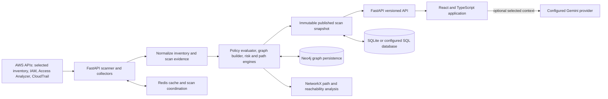

# CloudScope

CloudScope is an AWS security analysis application for inventorying selected cloud resources, modeling IAM access relationships, identifying configuration-based attack paths, tracking findings, and comparing proposed IAM policy changes. It combines a FastAPI backend, a React/TypeScript single-page application, AWS read APIs, relational snapshots, Redis coordination/cache, and graph analysis with NetworkX and Neo4j.

> **Project status:** CloudScope is an actively developed security-analysis prototype and portfolio project. It has not been independently security-certified or validated as a production managed service. It does not cover every AWS service or every AWS authorization rule. See [Industry readiness](docs/industry-readiness.md), [Current audit](docs/final-audit.md), and [Release readiness](docs/release-readiness.md) before evaluating it for deployment.

## Product purpose

CloudScope is intended to help a cloud administrator answer questions such as:

- Which IAM users, groups, roles, policies, and supported AWS resources were collected?
- Which modeled permissions connect an identity to a resource, and what action evidence supports that connection?
- Can a principal reach a sensitive asset through a role chain or a workload control path?
- Which security findings need review, and what evidence and remediation context are available?
- How might attaching or detaching several managed policies change posture, reachability, and attack paths?
- What did the application know at the time of a retained scan snapshot?

CloudScope describes **potential configuration capability** separately from **CloudTrail-observed activity**. A static path is not proof of compromise. An absent event is not proof that an action did not happen.

## Main features

| Area | What it provides |
| --- | --- |
| Dashboard | Scan state, security posture, resource/finding summaries, scan-region selection, and quick report actions. |
| Cloud Resources | Inventory of collected resource metadata for the configured AWS account and scanned regions. |
| Cloud Graph | Interactive identity, policy, workload, and resource relationships with filters, search, evidence details, and path focus. |
| Attack Paths | Ranked and grouped candidate paths, target/blast-radius summaries, relationship evidence, and optional AI explanations. |
| Security Findings | Finding evidence and lifecycle workflow such as acknowledge, resolve, suppress, assign, and reopen where authorized. |
| Policies | Scanned policy details, policy risk signals, attachment evidence, and searchable AWS/account managed policy catalog data where IAM permits. |
| What-If Analysis | Add multiple managed-policy attach/detach proposals for users, groups, and roles; compare current and proposed analysis without changing AWS. |
| Saved Changes | Reopen and edit an analyst's stored simulation change set for later comparison. |
| Snapshot History | Browse up to ten retained published scans, including region metadata; exit historical view to return to live data. |
| Alerts | Review selected CloudTrail security events and correlated findings with event details and optional AI explanation. |
| Reports | Export supported security summary data as CSV/JSON and the graph as SVG; backend report APIs provide summary and bounded JSON export. |
| Settings and Operations | Scan interval, account/region diagnostics, service health, scan status, and operational information according to role. |

Projects and per-account role onboarding are not part of the current UI workflow. A deployment scans the account selected by the backend's configured AWS credentials. To analyze separate accounts, use separately configured deployments and storage boundaries.

## System architecture



### Request and scan flow

1. The backend resolves AWS credentials from `AWS_PROFILE` or the AWS SDK credential chain and uses STS to identify the caller account.
2. A startup, scheduled, manual, or region-change trigger requests a scan. Redis-backed locking coordinates one scan at a time in a deployment; local development can fall back to process-local behavior if Redis is unavailable.
3. The scanner resolves the active region set and runs sixteen collector status groups concurrently. Collectors report data, successful empty results, or failures. A failed critical collector prevents an incomplete result from being published as a clean empty inventory.
4. Collected records are normalized into an inventory. CloudTrail activity and AWS Access Analyzer output are included where collection succeeds.
5. CloudScope builds relationships, evaluates supported policy constructs, identifies findings, calculates risk summaries, and searches bounded candidate paths.
6. A successful or partial completed scan is persisted with scan ID, status, region results, collection completeness, and snapshot time. Reads for a request use one pinned published snapshot so pages do not mix versions.
7. The frontend displays that evidence. An optional AI request sends a bounded selection of context to the configured Gemini provider.

Scheduled scans use a **fixed delay**: the scheduler waits for the current scan to finish, then waits the configured interval before starting another scan. A scan taking five minutes followed by a five-minute interval therefore does not cause an immediate overlap.

## AWS coverage and collection limits

The scanner has collectors for IAM users, groups, roles and policies; EC2; S3; Lambda; Secrets Manager; RDS; DynamoDB; ECS running tasks; ECR repositories; CodeCommit repositories; SQS; SNS; customer-managed KMS keys; EKS clusters; Step Functions state machines; IAM Access Analyzer findings; and recent CloudTrail security events. The status panel groups SQS, SNS, KMS, EKS, and Step Functions under `ExtendedAWS`.

This is a defined subset of AWS, not an all-services inventory. Collected record detail varies by service. Some service collectors read metadata or policy documents but never retrieve payloads, such as queue messages, topic messages, state-machine input, secret values, or key material. Review [AWS coverage and analysis model](docs/phase3-architecture.md) and [AWS collection setup](aws/templates/deployment_guide.md).

Region behavior:

- The UI can request one AWS region or a global sweep of enabled regions.
- A non-empty `SCAN_REGIONS` setting supplies a fixed configured region set unless the UI explicitly requests global mode.
- With no configured set, the backend discovers enabled regions through EC2 `DescribeRegions`; if discovery fails, it falls back to the session/default region.
- Regional errors and collector status must be checked before treating a missing resource as absent.
- Runtime UI region selection is held in process memory; review the scan's recorded regions after restarts or deployment changes.

The AWS principal should be dedicated and read-only. The sample policy is a starting point, not proof that every enabled collector has all required permissions. See [configuration reference](docs/configuration-reference.md) and [AWS connection guide](aws/templates/deployment_guide.md).

## How access paths are modeled

CloudScope's custom evaluator and graph pipeline model selected identity-policy, group-membership, role-trust/assumption, workload-role, resource-policy, database-connection, and resource relationships. Path transitions are checked against allowed relationship types; graph connectivity alone is not authorization evidence. The engine distinguishes action categories such as read, write, execute, access, and administrative capability and includes the matched policy/action evidence when available.

Workload compromise pivots are deliberately conditional. For example, a user who can **read EC2 metadata** is not automatically modeled as able to run code on that EC2 instance. A control-capable permission such as SSM command/session access or EC2 Instance Connect may create a potential execution pivot, but static inventory cannot verify every runtime prerequisite (such as SSM agent state, network access, credentials, or host configuration). Similar guarded logic exists for selected Lambda, ECS, and Step Functions transitions. Read the path evidence and limitations before acting.

Attack path generation is bounded (maximum six role hops and up to 200 emitted paths). Large graphs or unsupported authorization features may yield incomplete analysis. CloudScope risk scores are product-specific prioritization values, not AWS verdicts or compliance certifications.

### Capability and event evidence are different

| Evidence label | Meaning |
| --- | --- |
| Possible capability | Static configuration and supported policy semantics suggest the identity may perform the modeled transition. |
| Observed activity | A relevant CloudTrail event was collected. It records an AWS event, not necessarily malicious intent. |
| Correlated activity | An observed event matches a modeled capability or path transition according to the correlator. |
| Observed attack activity | A collected event matches an identified path transition under the product's correlation rules. |

CloudTrail coverage depends on event history availability, permissions, regions, event types, and retention. Lack of an event is inconclusive. See [Security analysis architecture](docs/phase3-architecture.md).

## What-If Analysis and saved changes

The simulation engine supports **managed policy attachment and detachment** for IAM users, groups, and roles. A change set may contain multiple changes; the application builds a desired-state copy, reruns the same analysis pipeline, and compares current and proposed posture, graph, reachable resources, blast radius, and attack paths. The before/after graph and added/removed paths are simulation results.

Changes can be previewed without saving, stored as a draft, edited or removed in Saved Changes, recalculated, or reset. Draft changes are persisted in SQL and scoped to the authenticated analyst identity. CloudScope does not call AWS IAM mutation APIs or write the proposed state into the live AWS inventory. The model is only as accurate as the evaluator, inventory and policy documents available in the current snapshot.

The simulation does not currently model arbitrary AWS API changes, inline policy editing, creation of a new IAM role, every policy type, or every authorization layer. It should not be treated as AWS IAM Policy Simulator output or change approval.

## Snapshots and persistence

Each published snapshot contains the scan identifier/time/status, region metadata and completeness, plus the collected identities, policies, resources, findings, risks, attack paths, graph data, and dashboard summary. The application retains up to `SNAPSHOT_RETENTION_COUNT` snapshots (default 10); the history endpoint returns up to ten. Historical mode is read-only and should be exited before interpreting the live account state.

- **SQL database:** durable scan runs and snapshots, finding lifecycle/history, audit records, simulation drafts, and application records. Local default is SQLite; PostgreSQL can be configured but production migration and restore procedures have not been validated.
- **Redis:** cache and scan-lock coordination. It is not the authoritative snapshot store.
- **Neo4j:** graph persistence and graph-loading support.
- **NetworkX:** in-process graph reasoning, reachability and attack-path calculations.

Schema setup currently uses SQLAlchemy table creation and compatibility column additions rather than a versioned migration system. Back up and rehearse restore/upgrade before using important data.

## Application structure

| Path | Responsibility |
| --- | --- |
| `backend/app/main.py` | FastAPI app lifecycle, middleware and API router registration. |
| `backend/app/routers/` | Feature APIs for scan, snapshots, graph, attack paths, policies, findings, alerts, reports, simulation, auth, audit, settings, health and operations. |
| `backend/app/services/aws/` | AWS session/identity handling and per-service read collectors. |
| `backend/app/services/scanner/` | Scan coordinator, region resolution, distributed lock, scan manager and immutable published snapshots. |
| `backend/app/services/attack/` | Policy evaluation, graph traversal, risk scoring, blast radius and CloudTrail correlation. |
| `backend/app/services/simulation/` | Desired-state policy changes, access computation, analysis comparison and graph/path diff. |
| `backend/app/persistence/` | SQLAlchemy models and repositories for durable application state. |
| `frontend/src/App.tsx` | Provider composition and page routing. |
| `frontend/src/pages/` | Dashboard, inventory, graph, attack-path, findings, policy, simulation, alert, report and settings screens. |
| `frontend/src/components/` | Shared navigation, graph, scan status, region, evidence and detail panels. |
| `frontend/src/api/` | Typed API adapters using the shared HTTP client. |

## API and user roles

The API is rooted at `/api/v1`; OpenAPI UI is available at `/docs` in a local deployment. API families cover dashboard; users, roles, policies and resources; graph and effective access; relationships and attack paths; findings, risks and alerts; reports; scans and snapshots; simulation; Copilot; audit; settings; operations; authentication/session; and health.

The backend defines `VIEWER`, `ANALYST`, `SECURITY_OFFICER`, and `ADMINISTRATOR`. Route guards enforce the minimum role server-side. Frontend visibility is not a security boundary. See [Authentication](docs/authentication.md) and [Roles and access control](docs/rbac.md).

## Local development

### Run backend and frontend separately

Requirements: Python version supported by `backend/requirements.txt`, Node.js/npm versions supported by the frontend lockfile, and AWS credentials if performing a live scan.

```powershell
# Terminal 1
cd backend
python -m pip install -r requirements.txt -r requirements-dev.txt
python -m uvicorn app.main:app --host 127.0.0.1 --port 8000

# Terminal 2
cd frontend
npm ci
npm run dev -- --host 127.0.0.1
```

Open `http://127.0.0.1:5173/`. The backend defaults to `http://127.0.0.1:8000`; the frontend's local API base can be changed with `VITE_API_BASE_URL`. Configure development authentication deliberately. A common isolated local setup uses `DEV_AUTH_MODE=true`; never expose development headers to an untrusted network.

The backend starts the scheduler on startup, which also requests a scan. Configure AWS credentials before startup to avoid expected credential/collector failures. Check the caller with `aws sts get-caller-identity` using the same profile/environment as the backend.

### Run the Compose development stack

1. Copy `.env.example` to `.env` and replace development passwords/secrets.
2. Configure `AWS_PROFILE`, `AWS_CREDENTIALS_DIR`, and any region settings for a read-only principal.
3. Run `docker compose -f compose.yaml up --build` from the repository root.
4. Open `http://localhost:8080`; API docs are at `http://localhost:8000/docs`.

See [Deployment](docs/deployment.md) for service ports, volumes, release Compose, and operational limits.

## Verification

```powershell
cd backend
python -m pytest -q
python -m compileall -q app tests

cd ..\frontend
npm test
npm run lint
npm run build
```

These are local checks only. The current verification record states exactly which subsets passed and which long-running or hosted checks remain unverified: [Final verification](docs/final-verification.md). Passing local checks does not establish a passing hosted workflow or production readiness.

## Documentation map

- [AWS coverage and analysis model](docs/phase3-architecture.md) — what CloudScope collects, how paths and evidence are computed, and analysis limits.
- [Industry readiness](docs/industry-readiness.md), [current audit](docs/final-audit.md), [release readiness](docs/release-readiness.md) — implementation status and open work.
- [Deployment](docs/deployment.md), [configuration reference](docs/configuration-reference.md), [operations](docs/operations.md), [observability](docs/observability.md) — running and operating the services.
- [Authentication](docs/authentication.md), [RBAC](docs/rbac.md), [security](docs/security.md), [secrets and data handling](docs/secrets.md) — security configuration and boundaries.
- [Audit logging](docs/audit-logging.md), [real AWS validation](docs/real-aws-validation.md), [security release checklist](docs/security-release-checklist.md) — evidence, testing and release process.
- [Documentation review](docs/documentation-verification.md), [verification notes](docs/final-verification.md) — review scope and check results.
